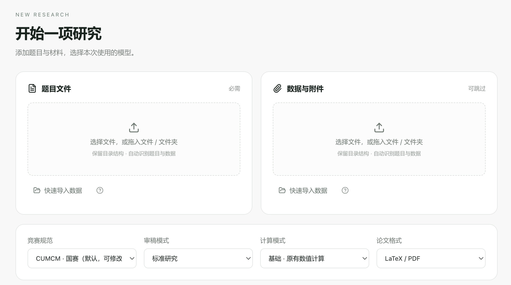

# Meta-Model-Agent

### 面向数学建模研究的智能工作台

Apple Silicon Mac 适配进行中 · 基于原作者项目的二次开发展示

[原作者项目：Meta-Code](https://github.com/WuXinbo-bo/Meta-Code) · [数学建模技能项目](https://github.com/WuXinbo-bo/Math-model-skills)

---

> **原作者：[WuXinbo-bo](https://github.com/WuXinbo-bo)**  ·  **二次开发 / Mac 适配：[scxai-top](https://github.com/scxai-top)**
>
> 本项目是在原作者项目基础上进行的二次开发，主要面向 Apple Silicon Mac 的适配与体验完善。原项目的设计、基础能力及相应版权归属保留；本页展示的是二创适配进展。

## 项目简介

Meta-Model-Agent 面向数学建模题目研究，目标是把问题分析、计算实验、结果核验与论文整理放进一套连贯的研究工作流中。这个页面介绍基于上游项目进行的 Apple Silicon Mac 适配工作与当前进度。

本项目仍在开发和测试阶段。这里展示的是适配进展，不代表原作者发布的官方 Mac 版本，也不代表完整科研流程已经验收通过。

## 界面预览

*本地 Mac 测试应用的实际界面局部：题目与数据导入、竞赛规范、审稿模式和论文格式。截图已裁切，不含个人研究材料或连接信息；界面展示不代表完整论文交付已经验收。*

## Mac 适配状态

| 项目 | 当前信息 |
| --- | --- |
| 目标设备 | Apple Silicon（M 系列，arm64） |
| 已验证系统 | macOS 15.3 |
| 其他设备与系统 | Intel Mac 及其他 macOS 版本尚未完成验收 |
| 应用发布 | 暂无公开安装包或 Release |
| 签名与公证 | 当前本机构建使用 ad-hoc 签名；未完成 Developer ID 签名或 Apple 公证 |
| 科研验收 | 完整研究任务到论文交付的端到端验收尚未完成 |

## 适配方向

- 适配 macOS 的应用启动、菜单、窗口生命周期与文件路径行为。
- 面向 M 系列芯片整理 Python 科学计算、LaTeX 与文档工具的环境配置流程。
- 验证研究任务运行、取消、恢复与计时等桌面端边界。
- 保留原项目的研究工作流与学术质量要求；适配工作不会以降低精度或跳过验证来换取更快的结果。

以上是当前开发方向，不等同于所有功能已完成或在所有 Mac 上通过验证。

## 原作者与二次开发说明

**原作者：[WuXinbo-bo](https://github.com/WuXinbo-bo)。本项目由 [scxai-top](https://github.com/scxai-top) 在原作者项目基础上进行二次开发，主要负责 Apple Silicon Mac 适配、桌面交互及相关环境兼容工作。**

| 角色 / 项目 | 说明 |
| --- | --- |
| 原作者 WuXinbo-bo | 原项目作者，保留原作者署名与项目来源 |
| [Meta-Code](https://github.com/WuXinbo-bo/Meta-Code) | 本客户端开发所基于的上游工程 |
| [Math-model-skills](https://github.com/WuXinbo-bo/Math-model-skills) | 原作者的数学建模智能体技能项目 |
| scxai-top | 本展示页维护者与 Mac 二创适配开发者 |

本项目保留上游版权与许可声明。后续计划在完善 Mac 版本后与原作者沟通审查、集成及协作；当前尚未合并到上游，也不是原作者发布的官方 Mac 版本。

## 代码与下载

此展示仓库只包含项目介绍与经过检查的界面截图，不包含应用源码、安装包、个人配置或研究数据。当前没有提供软件下载安装。GitHub 可能为本仓库生成文件快照；快照内容也仅限本页的公开介绍与截图文件，不含应用或其私有源码。

## 反馈

欢迎通过 [Issues](https://github.com/scxai-top/Meta-Model-Agent-Mac-Showcase/issues) 提交 Mac 适配建议或报告展示页问题。请勿在公开 Issue 中粘贴 API Key、访问令牌、个人研究材料或其他敏感信息。

---

**项目源自上游，Mac 适配仍在持续验证中。**

